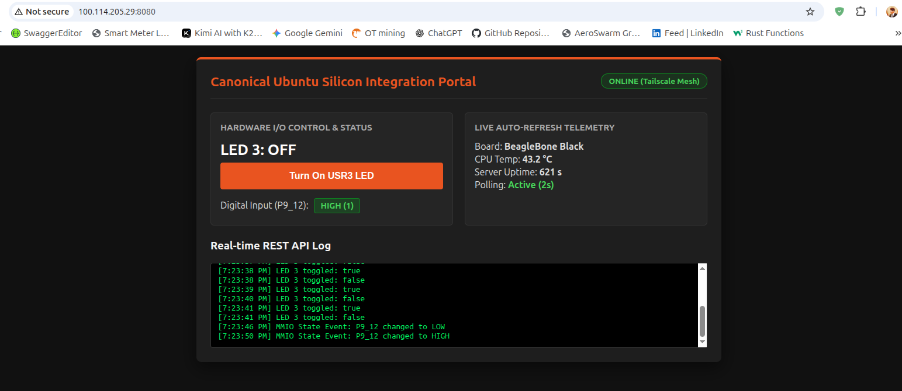

# AeroSwarm Edge Gateway 🚀

An ultra-low latency, production-grade IoT gateway and real-time management dashboard built from scratch in C++ for ARM/Linux embedded edge devices (optimized for BeagleBone Black running Ubuntu).

---

## Architecture

The system bridges low-level hardware registers directly to a secure, globally routable web interface without heavy middleware or runtime overhead:

[ Client Browser / CLI ]
│
▼ (Tailscale WireGuard Encrypted Mesh - Port 8080)
[ C++ Native REST Server (BeagleBone Black) ]
│
├──> Serves Embedded HTML5/JS Single-Page Dashboard (GET /)
├──> Polls Telemetry & MMIO Digital Input P9_12 (GET /api/telemetry)
└──> Validates Bearer Token & Writes to GPIO1 Registers (POST /api/led)


---

## Key Features

- **Zero-Overhead C++ REST Server:** Bare-metal socket architecture handling HTTP requests and telemetry streams with minimal memory footprint and zero external library dependencies.
- **Direct Silicon MMIO Control:** Direct hardware register mapping (`/dev/mem`) for microsecond-level GPIO control (USR3 LED toggling) and polling of digital input pins (P9_12).
- **Embedded Web Dashboard:** Single-file HTML5/JS responsive interface served directly from the embedded edge node, featuring auto-refreshing live telemetry (CPU temperature, server uptime, digital input status) and real-time API event logs.
- **Zero-Trust Security:** Built-in Bearer token authorization (`Natska_key`) protecting physical hardware execution endpoints.
- **Mesh Networking Ready:** Secured and routable globally over encrypted WireGuard tunnels via Tailscale.

---

## Project Structure

```text
aeroswarm-edge-gateway/
├── include/       # Header files and interface definitions
├── src/
│   └── main.cpp   # Core C++ socket server, MMIO engine, and embedded dashboard
├── build/         # Compiled binaries (generated locally)
└── README.md      # Project documentation
Quick Start Guide
1. Build the Gateway
From your project root directory on the BeagleBone Black:

Bash
mkdir -p build
g++ -O3 src/main.cpp -o build/iot_gateway_server -lpthread
2. Run the Server (Root required for MMIO /dev/mem)
Bash
sudo ./build/iot_gateway_server
3. Access the Dashboard
Open any browser on your Tailscale network and navigate to:

Plaintext
[http://100.114.205.29:8080/](http://100.114.205.29:8080/)
4. API Endpoints Reference
Fetch Live Telemetry (GET):

Bash
curl [http://100.114.205.29:8080/api/telemetry](http://100.114.205.29:8080/api/telemetry)
Control Hardware LED 3 (POST - Token Protected):

Bash
curl -X POST [http://100.114.205.29:8080/api/led](http://100.114.205.29:8080/api/led) \
  -H "Authorization: Bearer Natska_key" \
  -H "Content-Type: application/json" \
  -d '{"led": 3, "state": true}'
License
Open-source systems integration project built for edge computing and industrial IoT applications.
